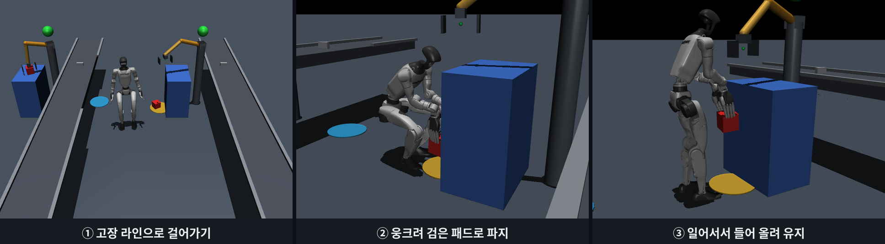
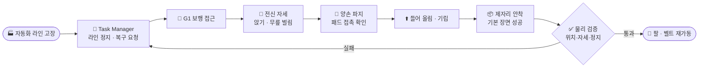
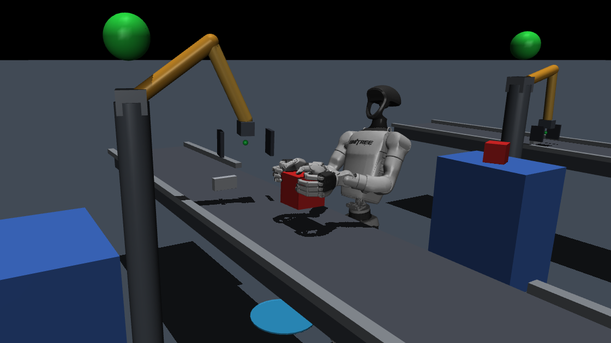
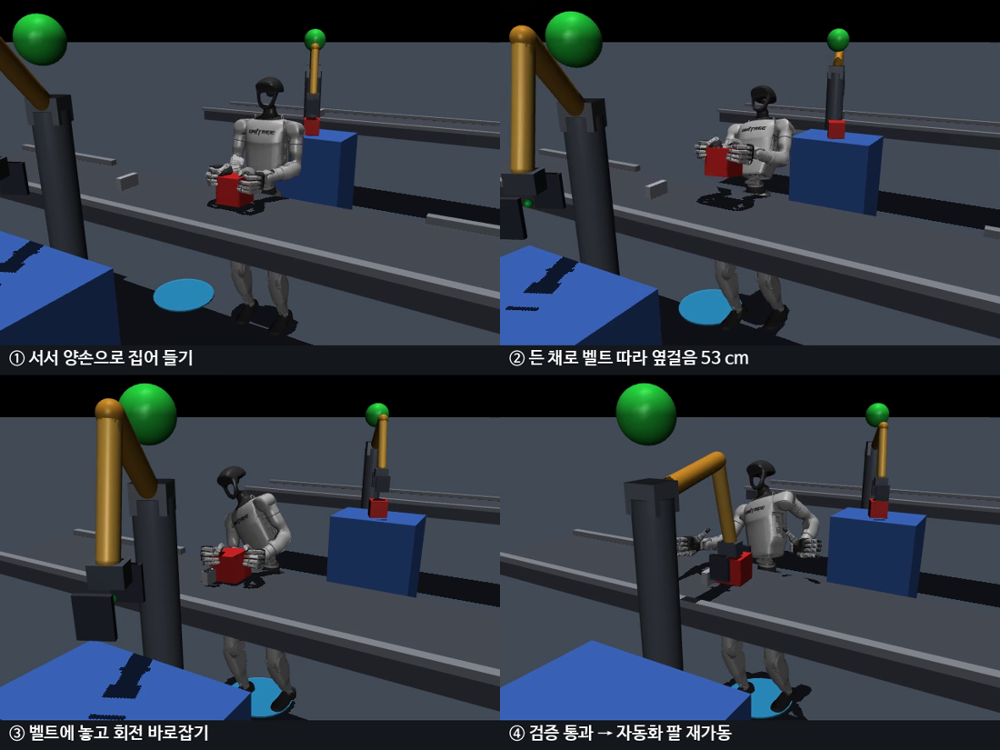
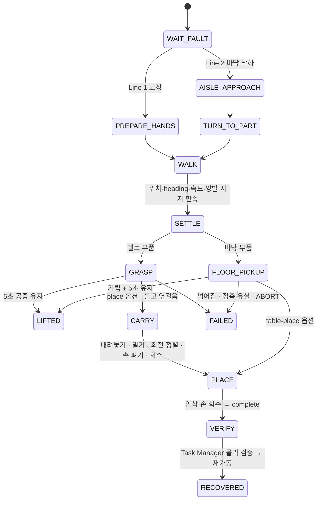
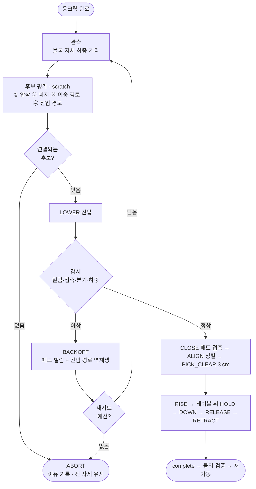
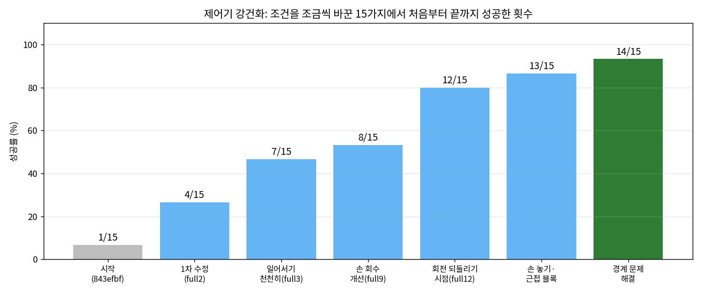
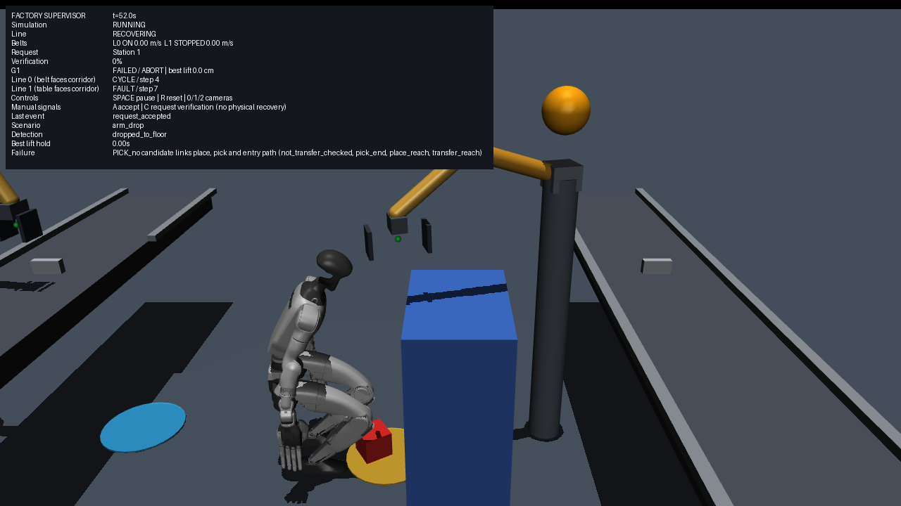
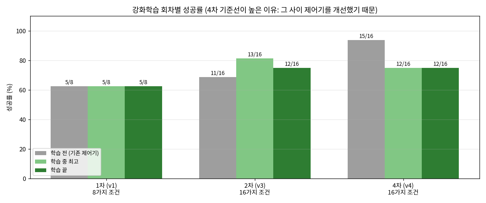

# 🤖 Humanoid Factory Supervisor — 공장 고장을 찾아가 전신으로 복구하는 휴머노이드

> **정상 생산은 자동화 팔·컨베이어가, 예외 상황 복구는 휴머노이드가.**
> MuJoCo 공장에서 Unitree G1이 고장 난 작업 셀로 **걸어가**, **앉고 서며 양손으로** 떨어지거나 걸린 부품을 복구합니다.

<p align="center">
  
</p>
<p align="center"><sub>Line 2 실제 실행 (seed 0) · 자동화 팔이 부품을 바닥에 떨어뜨림 → G1이 걸어가서 → 무릎을 벌려 웅크리고 손가락 끝 패드로 집어 → 일어서서 5초 유지</sub></p>

### ⚡ 한눈에 보기

| 항목 | 내용 |
|---|---|
| 🦾 로봇 | **Unitree G1** (다리 12 · 허리 3 · 팔 14) + **Sharpa Wave** 5지 양손 (손당 22 액추에이터) |
| 🏭 공장 | 라인 2개 · 각 라인에 컨베이어 + 자동화 팔 + 테이블 · 고장 주입과 Task Manager |
| 🧪 시뮬레이터 | MuJoCo 3.12 · 물리 2 ms · 제어 100 Hz |
| 🚶 보행 | Unitree 사전학습 G1 보행 정책(외부 도구) + 정밀 접근 제어 |
| 🔒 원칙 | 로봇은 **액추에이터 명령으로만** 움직입니다 — 물체 부착·순간이동·숨은 힘·충돌 끄기·성공 기준 완화 없음 |

### 🚦 현재 상태 (2026-10-23)

| 복구 시나리오 | 상태 | 핵심 실측 |
|---|:---:|---|
| **Line 1** 벨트 걸림 → 서서 양손 파지 → **들고 옆걸음 53 cm** → 벨트에 놓기·밀기·회전 정렬 → 손 회수 → 검증 → **라인 재가동** | ✅ | 기본 장면 RECOVERED · **무작위 100회 중 96회** · 조건 52개 중 49개(개발 12/12, 검증 37/40) |
| **Line 2** 바닥 낙하 → 웅크려 패드로 집기 → 기립 → **테이블 안착** → 손 회수 → 검증 → **라인 재가동** | ✅ | 기본 장면 RECOVERED 17,461 tick(재가동 관찰 포함) · **무작위 100회 중 80회** |
| Line 1 들어 올려 5초 유지 (기존 기준 경로) | ✅ | 4934 step · 79.5 mm 상승 |
| 강화학습(잔차 PPO)으로 성공률 개선 | ❌ | 3회 학습 모두 개선 없음 → 신뢰성은 제어기 수정으로 확보 ([아래](#-강화학습-실험-결과)) |
| 블록을 든 채 앞으로 장거리 보행 | ⏳ | 옆걸음 운반(53 cm)만 검증 · 긴 운반에서 블록이 손 안에서 기우는 문제 남음 |



---

## 📌 주요 기능 (Key Features)

### 1. 고장 주입 공장과 "물리로 확인하는" 복구 검증 (Factory & Verification)

- **두 라인, 두 고장**: 1.3 m 통로 양쪽에 독립 라인이 있습니다. **Line 1**은 벨트 위 부품 걸림(`jam`), **Line 2**는 자동화 팔이 부품을 테이블 밖 **바닥에 떨어뜨리는** 고장(`arm_drop`)입니다.
- **복구 요청 흐름**: 고장이 나면 Task Manager가 해당 라인을 멈추고 G1을 호출합니다. G1이 요청을 수락(`accept`)하면 복구 중(`RECOVERING`) 상태가 됩니다.
- **신호만으로는 재가동하지 않음**: G1이 "완료"를 보내도, 부품이 지정 위치 **60 mm 이내**, 기울기 **0.15 rad 미만**, yaw **±0.15 rad**(정육면체라 90° 대칭), 작업면 접촉, **정지 상태**를 **50 tick 연속** 만족해야만 팔을 리셋하고 벨트를 다시 돌립니다. 재가동 직전에도 다시 확인합니다.
- **보행 채점 기준(Navigation Gate)**: 위치 0.10 m · heading 0.15 rad · 1초 유지 · 넘어짐/금지 접촉 없음 · 올바른 셀 먼저 · 1500 step 이내. step당 0.05 m 넘는 base 이동은 **순간이동으로 실격**입니다.

### 2. 보행 접근 (Walk & Precision Approach)

- **사전학습 보행 정책**: 다리는 Unitree G1 보행 정책(BSD-3)이 담당합니다. 보행은 연구 대상이 아니라 주어진 도구입니다.
- **정밀 접근**: 부품 기준 목표 자세까지 오차에 비례한 속도 명령을 내고, **위치·heading·속도·양발 지지**를 모두 만족할 때만 서 있는 자세로 넘겨받습니다.
- **통로 우회 + 제자리 회전**: Line 2는 통로 중앙으로 먼저 이동하고, 빈 공간에서 방향을 튼 뒤 부품으로 접근합니다.

### 3. Line 1 — 선 채로 양손 파지 (Standing Bimanual Grasp)

<p align="center"></p>

- **연속 접근 궤적**: 걸으면서 들고 온 팔 자세에서 곧바로 블록 양옆으로 손을 가져갑니다.
- **접촉 후 squeeze + 재IK**: 양손을 3 mm씩 더 모으고, 실제 관절값에서 IK를 다시 풀어 1 cm/s로 들어 올립니다. 접촉 후 MuJoCo `noslip_iterations=10`으로 미끄럼 creep를 줄입니다.

#### 운반 · 놓기 · 재가동 (`--place`, 2026-10-23)

<p align="center"></p>

걸린 부품은 픽업 지점(블레이드 앞)에서 벨트를 따라 **53 cm** 떨어져 멈추므로, 팔만으로는 닿지 않습니다. 실패를 재현해 원인을 찾으며 아래를 차례로 넣었습니다.

| 문제(실측) | 해결 |
|---|---|
| 고장 난 자동화 팔이 픽업 지점 위에 집게를 벌린 채 멈춰 있어, 운반 중 블록이 집게에 19 N으로 부딪혀 빠짐 | 고장 수락 시 자동화 팔을 **자기 구동으로** 테이블 쪽 후퇴 자세로 이동 |
| 들고 걸으면 몸이 벨트에서 15 cm 뒤로 밀림 | 운반 중 전진 보정 명령 +0.10 |
| 내려놓은 뒤 손이 블록을 3~5 mm 띄워 벨트 지지가 안 잡힘 | 벨트 접촉이 끊기면 명령 높이를 0.1 mm/tick씩 눌러 내림 |
| 밀면서 블록이 손 안에서 17° 돎(검증 yaw 0.15 rad 초과) | 벨트가 받친 상태에서 **실제 블록 중심**을 축으로 손을 반대로 돌림(첫 회 1.6배, 개선 없으면 중단) |
| 손을 펼 때 약하게 쥔 블록이 18~19° 회전 | **손바닥을 먼저 벌린 뒤** 손가락을 폄(20조건: 동시 13 → 손바닥 먼저 17) |
| 손을 22 cm 당기는 IK 목표가 팔을 몸통에 70~325 N으로 눌러 손목에 52 N·m 유지 | 6 cm 들어 뗀 뒤 뒤 12 · 아래 4 · **바깥 10 cm**로 회수(팔 토크 10 N·m 이하) |
| 재가동한 자동화 팔 집게가 엄지를 쳐서 넘어짐 | 회수 자세를 검증·재가동 관찰 동안 유지 |

### 4. Line 2 — 바닥 부품 줍기 (Floor Pickup)

- **전신 자세 IK(WholeBodyPosture)**: 발을 바닥에 고정한 채 다리·허리·팔을 함께 풀어 **무게중심을 발 위에** 유지합니다. 경계 제약 최소제곱(BVLS)으로 관절 한계를 지키고, 계획용 모델에만 8 mm 자기충돌 여유를 둡니다(실제 물리 모델은 변경하지 않음).
- **엄지를 접는 바닥 집기**: 앉을 때는 엄지를 접어 두고, 손을 내리는 후반에 네 손가락을 폅니다.
- **검은 패드 + 무릎 벌림(`--pad-grip --frog-stance`)**: 손가락 끝의 elastomer 패드 면으로 블록 옆면을 잡습니다. 발끝을 돌리고 무릎을 벌려(무릎 폭 약 22 → 39 cm) 팔이 지나갈 길을 만듭니다.
  - 일어설 때 손 목표를 **실제 어깨 좌표계**에서 추종하고, **명령 손 위치**를 기준으로 서보해 squeeze를 유지합니다.
  - 패드 힘 측정에서는 단단한 손가락 껍질의 접촉력을 **제외**합니다. 껍질로 받친 것을 패드 파지로 세지 않습니다.

### 5. 관측 → 선택 → 실행 → 검증 → 재계획 루프 (Closed-Loop Recovery, `--table-place`)

바닥 블록을 테이블 지정 위치까지 옮기는 전체 복구를 위해, 기존 복구 FSM은 그대로 두고 그 둘레에 **폐루프 판단 구조**를 붙였습니다. LLM이나 외부 API는 쓰지 않으며, 선택 담당은 교체 가능한 인터페이스로 분리했습니다.

- **관측(Observe)**: 블록의 실제 위치·방향·속도, 몸 기울기, 양발 하중, 패드 하중, 손–다리 거리, 계획 오차를 읽습니다.
- **후보 평가(Evaluate)**: 실제 상태를 **복사한 scratch 데이터**에서 파지 계획 후보마다 아래 연결을 차례로 확인합니다. **끝점만이 아니라 경로 전체**를 봅니다.

  | 검사 | 확인 내용 |
  |---|---|
  | ① 안착 도달 | 발을 고정한 채 테이블 위 목표에 손이 닿는가 |
  | ② 파지 자세 | 웅크린 자세에서 블록 옆면에 패드가 닿는가 |
  | ③ 이송 경로 | 들어 올려 테이블 앞면을 넘겨 내려놓는 길 전체가 관절 한계 안인가 |
  | ④ 진입 경로 | 손이 무릎·블록에 닿거나 팔 해가 갑자기 뒤집히지 않는가 |

- **허용치 보정**: 경로 허용치는 이미 **물리적으로 성공한 진입 경로**를 같은 검사기로 결정 때마다 측정해 정합니다.
- **선택(Select)**: 모든 연결이 되는 후보만 고르고, 없으면 **이유를 붙여 제어된 중단(ABORT)** 을 합니다.
- **실행 중 감시(Verify)**: 블록이 밀리거나 돌면, 손이 다리를 계속 밀면, 계획 팔 자세가 급변하면, 패드 하중이 안 생기면 실패로 봅니다.
- **재계획(Replan)**: 이미 안정하게 지나온 **진입 경로를 거꾸로 되감아** 물러납니다. 그다음 블록을 다시 관측하고, 실패한 계획을 빼고 재선택합니다(최대 3회).
- **기록**: 판단마다 관측값, 후보별 탈락 이유, 선택과 근거, 실행 결과를 남깁니다. 뷰어는 종료 시 이를 출력합니다.

### 6. 재현성과 회귀 보호 (Reproducibility)

- **비트 단위 회귀 확인**: 새 기능은 옵션으로만 켜집니다. 변경 전후 기본 경로의 궤적(qpos·qvel·ctrl)을 매 tick 비교해 같음을 확인합니다.
- **데모 기록과 재생**: 25차원 action만이 아니라 preshape·엄지 명령과 solver 설정까지 포함한 **완전한 명령**을 기록합니다. Expert 없이 저장된 명령만 실행해 **1e-6 이내로 재현**됩니다.

---

## 🛠️ 시스템 설계 (System Architecture)

### 전체 구조

시스템은 **Perception(상태 읽기)** · **Decision(판단)** · **Control(제어)** 세 파트로 구성됩니다.

1. **Perception**: 카메라 대신 시뮬레이터의 실제 상태를 읽습니다. 부품 자세, 접촉 힘(패드/껍질 분리), 발 하중, 몸 기울기를 씁니다.
2. **Decision**: `FactoryRecovery`가 미션 FSM(고장 대기 → 접근 → 파지 → 들어 올림 → 안착 → 검증)을 총괄합니다. Line 2 테이블 경로에서는 `recovery_agent`가 후보를 평가·선택합니다.
3. **Control**: 다리는 보행 정책 또는 전신 자세 IK가, 팔은 IK·resolved-rate 서보가, 손은 손가락 그룹 시너지 명령이 맡습니다.

### 계층 구조

```
┌──────────────────────────────────────────────────────────────────┐
│  FactoryEnv  (envs/factory_env.py)                                │
│   두 라인 · 컨베이어 · scripted 자동화 팔 · 고장 주입 · Task Manager   │
└──────────────────────────────┬───────────────────────────────────┘
                               │ fault → accept / complete(검증 후 재가동)
┌──────────────────────────────▼───────────────────────────────────┐
│  FactoryRecovery  (expert/factory_recovery.py)   미션 FSM          │
│   WAIT_FAULT → AISLE/TURN/WALK → SETTLE → GRASP | FLOOR_PICKUP     │
│   → (CARRY) → PLACE → VERIFY → RECOVERED                          │
└──────┬───────────────────────┬──────────────────────┬────────────┘
       │ 보행                   │ Line 1                │ Line 2
┌──────▼─────────┐  ┌──────────▼──────────┐  ┌────────▼──────────────────┐
│ G1WalkPolicy   │  │ SharpaBimanual      │  │ FactoryFloorPickup         │
│ PrecisionApp-  │  │ GraspExpert         │  │  └ FloorTableCycle          │
│ roach          │  │ CoupledBilateralIK  │  │     + recovery_agent        │
│ (다리 12)       │  │ SharpaContactLift   │  │ WholeBodyPosture (BVLS IK)  │
└────────────────┘  └─────────────────────┘  │ SharpaPadGrasp (패드 면)     │
                                             └─────────────────────────────┘
┌──────────────────────────────────────────────────────────────────┐
│  SharpaGraspEnv 공유 뷰  (envs/sharpa_grasp_env.py)                 │
│   25D action = 허리 3 + 팔 14 + 손 시너지 8 · 중력 보상 · substep 안전  │
└──────────────────────────────────────────────────────────────────┘
```

### 모듈 구성

| 레이어 | 파일 | 역할 |
|---|---|---|
| 환경 | `envs/factory_env.py` | 공장, 라인 상태, 고장, Task Manager, 복구 검증 |
| 환경 | `envs/sharpa_grasp_env.py` | G1+Sharpa 조작 뷰(25D action), 접촉 집계 |
| 총괄 | `expert/factory_recovery.py` | 미션 FSM, 보행 인계, 넘어짐·금지 접촉 판정 |
| 보행 | `expert/g1_walk_policy.py` | 사전학습 보행 정책 래퍼 |
| 파지 | `expert/sharpa_bimanual_grasp_expert.py` | Line 1 양손 파지 Expert |
| 자세 | `expert/whole_body_posture.py` | 발 고정 전신 자세 IK (CoM·자기충돌·관절 한계) |
| 바닥 | `expert/factory_floor_pickup.py` | Line 2 웅크림·파지·기립 |
| 패드 | `expert/sharpa_pad_grasp.py` | elastomer 패드 기하·힘(껍질 제외) |
| 루프 | `expert/recovery_agent.py` | 관측·후보 평가·선택·결정 기록 |
| 루프 | `expert/factory_floor_table.py` | 바닥→테이블 실행·감시·후퇴·재계획 |

---

## 📊 알고리즘 플로우차트 (Logic Flow)

### 복구 미션 FSM (`FactoryRecovery`)



### 바닥 → 테이블 판단 루프 (`--table-place`)



---

## 📈 결과와 한계 (Results & Limitations)

### 전체 복구와 강건성 (2026-10-23)

| 시나리오 | 측정 | 결과 |
|---|---|---|
| Line 2 바닥 → 테이블 → 재가동 | 무작위 100회(블록 위치 ±15 mm, 질량 ±10 %, 고정 난수) | **80/100** |
| Line 2 | 조건 31개(개발 15 · 처음 보는 검증 12 · 테이블 근접 4) | 30/31 |
| Line 1 벨트 → 운반 → 벨트 → 재가동 | 무작위 100회(고장 시점 120~360 tick, 질량 ±10 %, 고정 난수) | **96/100** |
| Line 1 | 조건 52개(개발 12 · 검증 40) | 49/52 (개발 12/12, 검증 37/40) |
| 재현성 | 같은 조건 2회 실행 | 17,461 tick으로 비트 단위 동일 |

<p align="center"></p>
<p align="center"><sub>Line 2 제어기 강건화 · 조건을 조금씩 바꾼 15가지에서 처음부터 끝까지 성공한 횟수(1/15 → 14/15)</sub></p>

- 처음 Line 2 전체 복구는 손 위치를 0.0015 mm만 바꿔도 실패하는 아슬아슬한 성공이었습니다. 실패를 재현해 힘·자세를 기록하고 원인별로 고쳐 위 수치까지 올렸습니다.
- 남은 약점
  - Line 2: 블록이 테이블 앞면 3.3~5.5 cm에 떨어진 경우 14번 중 6번만 성공합니다(일어서며 손을 굴리는 구간에서 블록이 미끄러짐).
  - Line 1: 가장 멀리 운반하는 경우 블록이 손 안에서 기운 채 도착해, 밀기가 목표 3.5~3.8 cm 앞에서 멈춥니다(2건).
- "성공"은 정해진 검증 기준을 통과했다는 뜻입니다. 충돌 없는 동작이나 범용 정책을 뜻하지 않습니다.

### ⏱️ Python 기준 버전 (2026-10-23, 이후 C++ 이식의 비교 기준)

| 항목 | Line 1 | Line 2 |
|---|---:|---:|
| 성공률(무작위 100회) | **96 %** | **80 %** |
| 기본 장면 1회 시뮬레이션 시간 | 91 s | 175 s |
| 1회 실제 계산 시간(단독 실행) | 108 s | 440 s |
| 실시간 대비 속도 | 0.85배 | 0.40배 |
| 제어 1 tick 계산 시간 | 11.8 ms | 25.2 ms |
| CPU · 최대 메모리 | 1코어 · 1.26 GB | 1코어 · 1.67 GB |

- 측정 PC: Ubuntu 22.04, Python 3.10, MuJoCo 3.12, 노트북 CPU 1코어(`OMP_NUM_THREADS=1`). 무작위 시험은 메모리 때문에 4개씩 동시 실행합니다.
- Line 2 계산 시간의 약 71 %는 파이썬 전신 자세 IK(BVLS)입니다. 물리 계산은 약 17 %라 GPU 병렬 시뮬레이터만으로는 빨라지지 않아(최대 약 1.2배), 제어기를 C++로 옮기는 방향을 택했습니다.

### 과거 실패 기록 — 2026-09-28 후보 검사 경로

아래는 당시 제한된 파지·이송 후보의 결과입니다. 이후 `843efbf`에서 이송 경로·패드 접촉·
안착 판정을 수정해 기본 장면 전체 복구에 성공했습니다. 아래 ABORT는 현재 기본 경로가 아닙니다.

당시 물리로 확인된 단계와 막힌 지점은 다음과 같습니다.
- **확인된 단계**: 검증된 진입 자세를 거친 손 진입, 8개 패드 접촉(껍질 지지 아님), 바닥 위에서 블록을 −31~−34° 돌려 테이블 축에 정렬(잔차 3~4°), 3 cm 들어 올림.
- **감시 동작**: 블록 13 mm 밀림을 감지해 역재생으로 물러난 뒤 재판단했고, 넘어지지 않았습니다.
- **막힌 지점**: 패드 파지 하나로는 두 조건을 **동시에** 만족할 수 없습니다.

| 조건 | 필요한 손가락 각도(수평 아래) | 근거 |
|---|---|---|
| 웅크린 채 바닥 블록 집기 | **약 55° 이상** | 50° 이하는 파지 자세 도달 오차 27 mm 이상 |
| 발을 고정한 채 테이블 앞면 넘기기(몸 앞 높은 곳) | **약 50° 이하** | 55~70°는 이송 경로 오차 16~50 mm, 관절 한계 구간 50~80% |

- 이 판단이 들어가기 전 실행한 기립 **4회**는 모두 같은 구간(블록 높이 0.45~0.5 m)에서 팔 관절이 한계에 닿아 파지를 잃었습니다.
- 당시 선택기는 이를 **실행 전에** 판단해 ABORT했습니다. 로봇은 멈추고 블록은 바닥에 남았습니다.

<p align="center"></p>
<p align="center"><sub>2026-09-28 과거 후보 평가 화면 · 연결되는 후보가 없어 ABORT (현재 성공 경로와 구분)</sub></p>
- 다음 단계에는 **발 위치를 바꾸는 수단**이 필요합니다. 후보는 준정적 한 걸음 제어기, 운반 자세 보행 재학습, 손 안 재파지이며 결정 대기 중입니다.

### 블록을 든 채 걷기 — 시험 범위

| 시험 조건 | 결과 |
|---|---|
| 블록 없이 팔 앞으로 + 0.3 m/s 명령 1.5초 | 거의 전진하지 않음 → 명령 없이 0.15 m 밀림 · 피치 12° · 정지 못 함 |
| **Line 1: 블록을 들고 벨트를 따라 옆걸음 53 cm** | ✅ 전진 보정 +0.10, 쥐는 힘 흔들림 표준편차 약 1 N · 조건 52개 중 49개 전체 복구 |
| 블록을 들고 앞으로 장거리 보행 | 미시험 |

---

## 💻 개발 환경 (Environment)

| 항목 | 버전 |
|---|---|
| OS | Ubuntu 22.04.5 LTS |
| Python | 3.10.12 |
| MuJoCo | 3.12.0 |
| NumPy / SciPy | 2.2.6 / 1.15.3 |
| PyTorch | 2.6.0 (+cu124, 보행 정책 추론) |
| Gymnasium · PyYAML | `requirements.txt` 참고 |
| GPU | NVIDIA GeForce RTX 3060 Laptop (렌더링) |

> ⚠️ 이 개발 PC에서는 EGL 오프스크린 렌더링이 동작하지 않습니다. 렌더링은 `MUJOCO_GL=glfw`와 `DISPLAY=:0`을 씁니다(아래 '자주 겪는 문제' 참고).

---

## ⚙️ 로봇 · 환경 사양 (Robot & Scene)

### 로봇

| 항목 | 사양 |
|---|---|
| 본체 | Unitree G1 · 다리 12 · 허리 3 · 팔 14 자유도 |
| 손 | Sharpa Wave 5지 × 2 · 손당 22 액추에이터 · 손가락 끝 elastomer 패드 |
| 조작 action | 25D = 허리 3 + 팔 14 + 손 시너지 8 (엄지·검지·중지·약지+새끼 × 좌우) |
| 제어 주기 | 물리 2 ms × frame_skip 5 = 10 ms (100 Hz) |
| 보행 | Unitree 사전학습 G1 보행 정책 (다리 12 관절) |

### 공장 장면

| 항목 | 값 |
|---|---|
| 라인 | Line 1(index 0) 벨트 `jam` · Line 2(index 1) 바닥 낙하 `arm_drop` |
| 부품 | 12 cm 정육면체 · 0.1 kg |
| Line 2 테이블 | 윗면 높이 0.75 m · 앞면 x = 0.65 m · 지정 위치 (0.82, 1.02) |
| 복구 검증 | 위치 60 mm · 기울기 0.15 rad · yaw ±0.15 rad(90° 대칭) · 작업면 접촉 · 정지 · 50 tick |
| 자동화 팔 | scripted 관절 궤적 · 고장 시 정지 · 검증 후 새 사이클로 재시작 |

---

## 📦 설치 (Installation)

### 1. Python 라이브러리

```bash
pip install -r requirements.txt
```

### 2. 외부 자산 (⭐ 필수 — 저장소에 직접 포함되지 않음)

```bash
python3 scripts/install_sharpa_wave_assets.py   # Sharpa Wave 손 모델
python3 scripts/install_g1_walk_policy.py       # Unitree G1 보행 정책 (BSD-3)
```

출처와 라이선스는 `assets/robots/sharpa_wave/NOTICE.txt`, `assets/policies/g1_walk/NOTICE`에 있습니다.

### 3. 설치 확인

```bash
python3 scripts/test_sharpa_wave_model.py
python3 scripts/test_sharpa_g1_integration.py
python3 scripts/test_factory.py
```

---

## 🚀 실행 (How to Run)

### 공장 복구 뷰어

```bash
DISPLAY=:0 python3 scripts/view_factory.py                                    # 고장 장면만
DISPLAY=:0 python3 scripts/view_factory.py --recover --fault-workcell 0       # ✅ Line 1 들어 올리기
DISPLAY=:0 python3 scripts/view_factory.py --recover --fault-workcell 0 \
  --place --restart-observe-steps 800                                         # ✅ Line 1 전체 복구(운반·놓기·재가동)
DISPLAY=:0 python3 scripts/view_factory.py --recover --fault-workcell 1       # ✅ Line 2 복구(기본 파지)
DISPLAY=:0 python3 scripts/view_factory.py --recover --fault-workcell 1 \
  --pad-grip --frog-stance                                                    # ✅ Line 2 패드 + 무릎 벌림
DISPLAY=:0 python3 scripts/view_factory.py --recover --fault-workcell 1 \
  --pad-grip --frog-stance --table-place --restart-observe-steps 1500        # ✅ Line 2 전체 복구(바닥→테이블→재가동)
```

| 키 | 동작 |
|---|---|
| `SPACE` | 일시정지 / 재개 |
| `R` | 처음부터 다시 실행 |
| `0` / `1` / `2` | 전경 / Line 1 / Line 2 카메라 |
| `A` / `C` | (복구 없이) 수동 수락 / 검증 요청 신호 — 물리 복구를 대신하지 않음 |

### 수치 평가 · 오프스크린

```bash
python3 scripts/evaluate_factory_recovery.py --station 0 --motion-profile smooth
python3 scripts/evaluate_factory_recovery.py --station 1 --motion-profile smooth --pad-grip --frog-stance
MUJOCO_GL=glfw DISPLAY=:0 python3 scripts/view_factory.py --recover --fault-workcell 1 \
  --offscreen --camera line1 --steps 9400 --capture 7600 9350 --out results/factory/line2.png
```

### 성능 옵션

| 옵션 | 기본값 | 설명 |
|---|:---:|---|
| `--display-hz` | 50 | 창 갱신 주기만 줄입니다. 물리·제어는 매 tick 실행합니다. |
| `--posture-solve-interval` | 1 | 바닥 자세 IK를 N tick마다 다시 풉니다. N=2는 패드 경로에서 접촉을 더 일찍 잃어 기본값으로 채택하지 않았습니다. |
| `--restart-observe-steps` | 0 | 재가동 검증 후에도 로봇 자세를 유지하며 자동화 팔의 작업 재개를 N tick 기록합니다. |

### 고정 몸통 양손 파지 (기반 작업, Phase 4.5)

```bash
DISPLAY=:0 python3 scripts/view_whole_body.py --grasp --no-restart
DISPLAY=:0 python3 scripts/view_whole_body.py --grasp --free-base --no-restart   # 두 발로 선 채
OPENBLAS_NUM_THREADS=1 python3 scripts/test_sharpa_grasp_lift.py --seeds 0 1 2
python3 scripts/evaluate_sharpa_workspace.py --suite all --workers 3
python3 scripts/sharpa_demos.py collect --output datasets/sharpa_pilot_v1 --count 10
```

- 12 cm / 0.1 kg 블록을 양손으로 들어 공중 5초 유지합니다. 손을 열면 떨어지는 것까지 검증합니다.
- 같은 제어기로 **14개 평가 조건 + 조합 4개**에서 성공했습니다(수정 전 14개 중 2개). 범위는 X/Y ±5·10 mm, 11~13 cm 정육면체, 10×15×10 cm 직육면체, yaw ±5°입니다.
- 기록한 파일럿 데모 10개는 재생은 1e-6 이내로 재현되지만, **학습용으로 승인된 데이터는 아닙니다**(`learner_ready=False`).

### 테스트

```bash
python3 scripts/test_factory.py              # 공장·고장·검증 계약 (22)
python3 scripts/test_factory_recovery.py     # 복구 FSM 계약 (12)
python3 scripts/test_floor_pad_planning.py   # 패드 기하·계획 모델
python3 scripts/test_factory_place.py        # place 계약
python3 scripts/test_recovery_agent.py       # 판단 루프 계약 (6)
```

---

## ⚠️ 자주 겪는 문제 (Troubleshooting)

| 증상 | 원인 | 해결 |
|---|---|---|
| 오프스크린 렌더링이 EGL 오류로 실패 | 이 PC의 EGL 드라이버 문제 | `MUJOCO_GL=glfw DISPLAY=:0` (+ 노트북 NVIDIA: `__NV_PRIME_RENDER_OFFLOAD=1 __GLX_VENDOR_LIBRARY_NAME=nvidia`) |
| Sharpa/보행 자산 없음 오류 | 외부 자산 미설치 | `scripts/install_sharpa_wave_assets.py`, `scripts/install_g1_walk_policy.py` 실행 |
| `os.fork` 자식 프로세스가 멈춤 | torch 스레드 풀이 fork 뒤 교착 | `OMP_NUM_THREADS=1`로 실행 |
| GUI가 실시간보다 느림 | 바닥 자세 IK가 tick당 8회 반복 | `--display-hz`로 창 갱신을 줄임 (물리는 그대로) |
| `--table-place`가 약 2분 멈춘 듯 보임 | 결정 시점의 후보 경로 검사(벽시계 약 2분, 시뮬레이션 시간은 정지) | 정상 동작. 종료 시 판단 기록이 출력됨 |
| `test_factory_task_frames.py` 실패 | 테스트의 가짜 객체가 현재 바닥 파지 코드보다 오래됨(이번 변경 이전부터) | 알려진 문제 |

---

## 📂 저장소 구조

```
Humanoid_Factory_Supervisor/
├── humanoid_learning/
│   ├── envs/          # FactoryEnv, SharpaGraspEnv, G1+Sharpa 모델 빌더, 설정
│   ├── expert/        # 복구 FSM, 보행, 파지, 전신 자세 IK, 바닥 파지, 판단 루프
│   ├── data/          # 데모 기록·재생 (SharpaGraspCommand)
│   ├── imitation/     # BC 데이터셋·정책·학습기
│   └── evaluation/    # 평가 지표
├── scripts/           # 뷰어(view_*), 평가(evaluate_*), 설치(install_*), 테스트(test_*)
├── assets/            # 외부 자산 NOTICE·LICENSE·체크섬 (본체는 설치 스크립트로)
├── configs/           # 학습·평가 설정
├── media/             # README 이미지
└── README.md
```

설계 메모, 실험 기록, 세션 인수인계(`PROJECT_CONTEXT.md`, `docs/`)는 로컬 전용이며 Git에 올리지 않습니다. 저장소에 올리는 Markdown은 이 README 하나입니다.

---

## 🗺️ 개발 순서 (Roadmap)

| 단계 | 상태 |
|---|---|
| Phase 1~3 · 조작 기반·BC 파이프라인 | ✅ 완료 |
| Phase 4.5 · Sharpa Wave 양손 파지 | ✅ 기능 성공 (Dex3 연구는 `phase4/dex3-grasp_Dex3손파지` 브랜치) |
| Phase 5 · 공장 환경 + 보행 접근 + Line 1·2 전체 복구 | ✅ Line 1 49/52 · Line 2 무작위 80/100 |
| 강화학습(잔차 PPO) 실험 | ✅ 3회 수행 · 성공률 개선 없음 → 역할 재정의 |
| Python 기준 버전 고정 | ✅ Line 1 96/100 · Line 2 80/100 · 1회 108 s / 440 s (결과 절의 기준 버전 표) |
| C++ 이식 → ROS 2 연동 | ⏸️ Python 기준 버전과 같은 결과인지 단계별 비교하며 이식 |

---

## 🧪 강화학습 실험 결과

기존 제어기·보행 정책·Task Manager는 그대로 두고, PPO가 손 목표 위치에 수 mm 보정(과 4차에서는 단계별 진행 속도)을 더하는
**controller-assisted residual RL**을 실험했습니다. 전신 동작을 처음부터 학습하거나 기존 제어기를 대체한 것이 아닙니다.

<p align="center"></p>

| 회차 | 바꾼 것 | 학습 전 → 학습 후 |
|---|---|---|
| 0차 | 첫 시도 | 15번 중 0번 — 기존 제어기가 0.0015 mm 차이에도 실패할 만큼 예민해 배울 기회가 없었음 |
| 1차 (v1) | 병렬 수집, 성공 위주 보상 | 5/8 → 5/8 |
| 2차 (v3) | 개입 구간을 들고 있기~놓기로 축소, 내려놓기 품질 점수 | 11/16 → 13/16(중간) → 12/16 |
| 4차 (v4) | 진행 속도 행동 추가, 시간·충돌 힘·흔들림 보상 | 15/16 → 11/16 → 12/16 |

- 1회 시도가 8~9분이라 하룻밤 50~100회가 한계였고, 1~2 mm 차이에도 결과가 갈리는 동작에서 탐색 잡음이 성공률을 떨어뜨렸습니다.
- 그래서 **신뢰성(성공률)은 측정 기반 제어기 수정으로**, 최적화는 "성공률이 떨어지면 채택하지 않는" 저차원 정책 탐색으로 역할을 나눴습니다.
- 성공률을 올린 것은 강화학습이 아니라 제어기 수정입니다(Line 2 조건 15개 1/15 → 14/15).

### 실행

```bash
# 병렬 잔차 PPO (보상 v4: 전체 흐름 최적화, 진행 속도 행동 포함)
OMP_NUM_THREADS=1 python3 scripts/train_recovery_ppo_parallel.py --output results/factory/rl/ppo_v4 \
  --workers 2 --updates 160 --reward-version v4

# 그래프·고정 조건 평가 행렬·영상
OMP_NUM_THREADS=1 python3 scripts/recovery_rl_report.py results/factory/rl/ppo_v4 --videos

# 수치/저장 테스트 (--physics: 실제 보행→접근과 행동 영향까지 확인)
OPENBLAS_NUM_THREADS=1 python3 scripts/test_recovery_ppo.py --physics
```

- 관측: 관절 위치·속도·제어 목표, 물체 자세, 작업 단계·시간, 손 그룹 접촉력·발 하중, 이전 행동(2프레임 이력).
- 행동: 손 목표 ±15 mm, 조임 ±4 mm의 잔차(4차는 진행 속도 0.7~1.3배 추가). 0이면 기존 제어 그대로입니다.
- 메모리 보호: 여유 메모리가 부족하면 수집을 일시정지하고, 환경을 여러 번 다시 만든 작업 프로세스는 교체합니다.
- 소스 fingerprint·관측·행동·환경 설정이 다르면 체크포인트 평가를 거부합니다. 학습·평가 중에는 소스를 바꾸지 마십시오.
- 학습 보상 상승이나 단일 장면 성공은 범용성 개선을 증명하지 않습니다. 같은 조건으로 보정 0과 정책을 비교하십시오.
